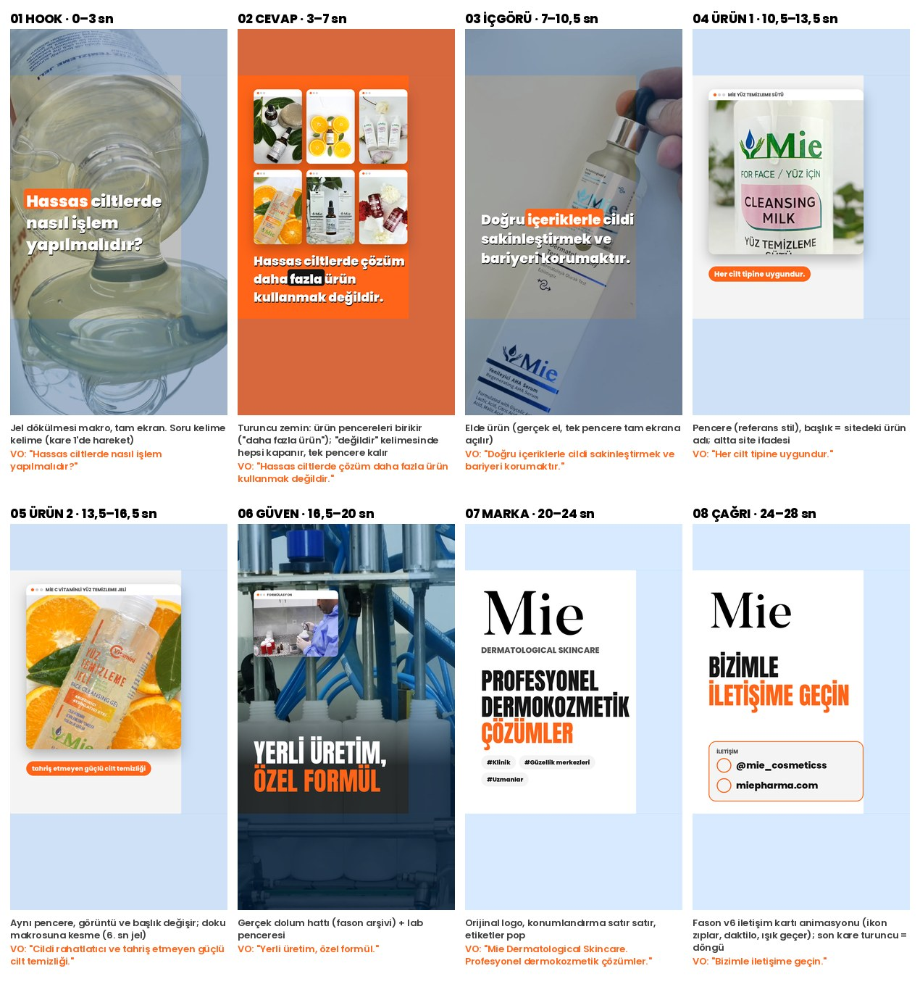

# Kozmetik Reels — Storyboard v1 "Hassas cilt"

**Kitle:** klinik, güzellik merkezi, uzman (IG bio). **Süre:** ~28 sn · 9:16 · fason v6 görsel sistemi (Anton + Poppins, site paleti, güvenli alan).
**Tek fikir:** Hassas ciltte çözüm daha fazla ürün değil, doğru içerik.

## Metin ve kaynaklar (hepsi birebir)
| Sahne | Ekran / dış ses | Kaynak |
|---|---|---|
| 01 Hook | Hassas ciltlerde nasıl işlem yapılmalıdır? | @mie_cosmeticss Reels 02.07.2026 ekran yazısı |
| 02 Cevap | Hassas ciltlerde çözüm daha fazla ürün kullanmak değildir. | aynı Reels caption |
| 03 İçgörü | Doğru içeriklerle cildi sakinleştirmek ve bariyeri korumaktır. | aynı Reels |
| 04 Ürün 1 | MİE YÜZ TEMİZLEME SÜTÜ · Her cilt tipine uygundur. | miepharma.com/urun/mie-yuz-temizleme-sutu-150-ml/ |
| 05 Ürün 2 | MİE C VİTAMİNLİ YÜZ TEMİZLEME JELİ · tahriş etmeyen güçlü cilt temizliği | miepharma.com/urun/mie-c-vitaminli-yuz-temizleme-jeli-200-ml/ ("Cildi rahatlatıcı ve tahriş etmeyen güçlü cilt temizliği sunmak için geliştirilmiştir.") |
| 06 Güven | Yerli üretim, özel formül | IG bio ("Yerli üretim,Özel formül") |
| 07 Marka | Mie · DERMATOLOGICAL SKINCARE · Profesyonel Dermokozmetik çözümler · #Klinik #Güzellik merkezleri #Uzmanlar | IG bio |
| 08 Çağrı | Bizimle iletişime geçin · @mie_cosmeticss · miepharma.com | site ("bizimle iletişime geçin"), IG profil, site |

**Yazılmayanlar (kural 12):** "Temiz içerik" (onay gerekir), akne/leke/egzama/kırışıklık iddiaları, "dermatolojik test", fiyat, satış noktası.

## Görüntü
Ürün videoları (Drive OneDrive_3, 720×1280): 06 jel dökülmesi 4–8 sn, 07 elde AHA 5–7 sn, 05 temizleme sütü 3–8 sn, 06 jel portakal 9–13 sn. Eski logo animasyonu olan kareler ve "Kırışıklık karşıtı" etiketli kareler (07: 7–12 sn) kullanılmaz. Fabrika: MIE_28 (1080p), lab: MIE_6.
Not: Ambalajların üzerinde eski yeşil logo var (gerçek ürün etiketi, grafik değil).
