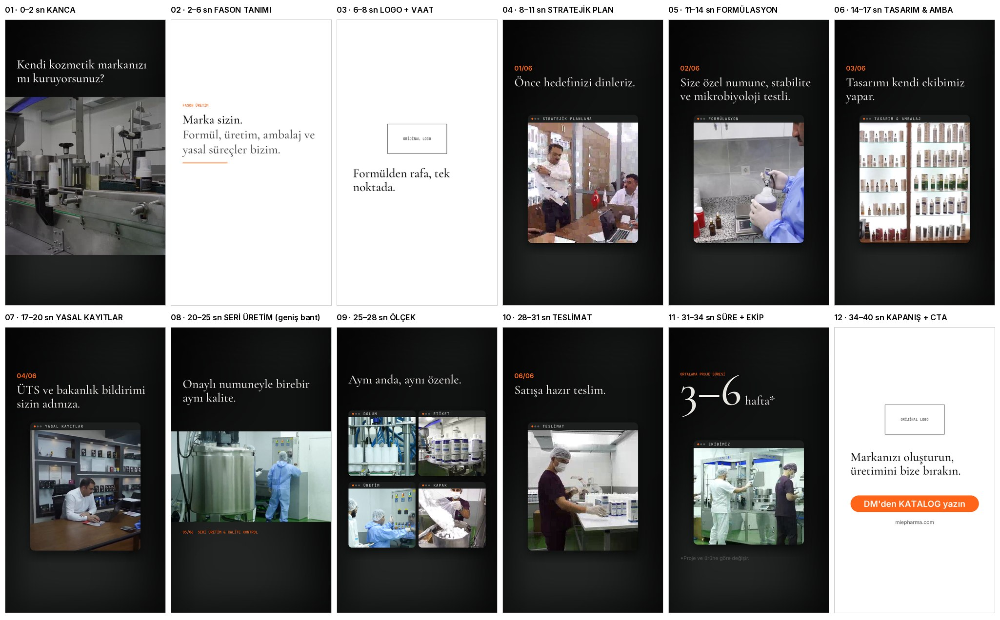

# Aşama 4 — Storyboard v2

**Amaç:** Fason ürettirmek isteyenlere markayı tanıtan, sabitlenecek Reels. Büyük makineler ve gerçek tesis, büyük şirket izlenimi vermeli.
**Süre:** ~40 sn · 9:16 1080×1920 · 4:5 grid kapağı ortada güvenli.

## Yapı

| # | Süre | Düzen | Görüntü | Ekran metni |
|---|---|---|---|---|
| 01 | 0–2 | **Geniş bant, dev makine** + itme zoom | MIE_30 dolum hattı | Kendi kozmetik markanızı mı kuruyorsunuz? |
| 02 | 2–6 | **Fason tanımı animasyonu** (beyaz zemin, kelime kelime) | — | FASON ÜRETİM · Marka sizin. Formül, üretim, ambalaj ve yasal süreçler bizim. |
| 03 | 6–8 | Beyaz zemin, **orijinal logo** + vaat | — | Formülden rafa, tek noktada. |
| 04 | 8–11 | Pencere (referans stil) | MIE_43 toplantı | 01/06 Önce hedefinizi dinleriz. |
| 05 | 11–14 | Pencere | MIE_6. lab | 02/06 Size özel numune, stabilite ve mikrobiyoloji testli. |
| 06 | 14–17 | Pencere | MIE_45 → MIE_44 ambalaj rafları | 03/06 Tasarımı kendi ekibimiz yapar. |
| 07 | 17–20 | Pencere | MIE_49 ofis | 04/06 ÜTS ve bakanlık bildirimi sizin adınıza. |
| 08 | 20–25 | **Geniş bant, hızlı kesmeler** (dev kazan, panolar) | MIE_7 · YENI_MIE_10–13 · MIE_9 · MIE_41 | 05/06 Onaylı numuneyle birebir aynı kalite. |
| 09 | 25–28 | **Çoklu pencere (ölçek)** | MIE_28 · MIE_38 · MIE_9 · MIE_34 | Aynı anda, aynı özenle. |
| 10 | 28–31 | Pencere | MIE_39 → YENI_MIE_18 transpalet | 06/06 Satışa hazır teslim. |
| 11 | 31–34 | Büyük rakam + pencere | MIE_33 ekip | Ortalama proje süresi 3–6 hafta* |
| 12 | 34–40 | Beyaz zemin, **orijinal logo** + CTA | — | Markanızı oluşturun, üretimini bize bırakın. · DM'den KATALOG yazın · miepharma.com |

## Görsel sistem (kurumsal kimlik)
- Logo: **orijinal siyah serif "Mie"** (dosya bekleniyor), beyaz zemin üzerinde. Değiştirilmez, yeniden çizilmez.
- Renk: site paleti: siyah `#000`, beyaz `#FFF`, gri `#555555`, vurgu turuncu `#ff6418` (sadece adım numarası, etiket noktası, CTA)
- Font: gövde/etiket **Montserrat** (site). Başlık: serif (logoyla uyumlu) **ya da** Montserrat. Karar bekliyor
- Instagram: alt ~380 px (açıklama/butonlar) ve sağ ~140 px (ikonlar) boş. Yazılar y 250–1500 arasında

## Ritim
Bölüm 01 ve 08–09 hızlı kesme (müzik vuruşlarına), adımlar 3'er sn sakin. Geçiş: pencere yükselir, etiket yazılarak değişir, başlık bulanıktan netleşir.
