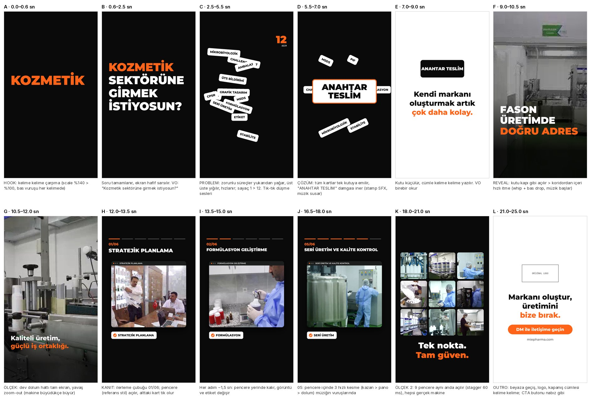

# Aşama 4 — Storyboard v4: "12 Adımlık Liste"

## Büyük fikir
Kozmetik markası kurmak isteyen kişinin karşısına çıkan **zorunlu süreçler listesi**, ekrana yağıp üst üste yığılır (problem). Hepsi tek bir **"ANAHTAR TESLİM"** kutusuna emilir (çözüm). Kutu kapı gibi açılır ve **gerçek fabrikaya** girilir (kanıt + ölçek).
Ogilvy: kitleyi işaretleyen soru ile açılış, problem–çözüm, gösterim (demonstration), tek vaat, tek çağrı. Brag: hook 2 sn, Hook > Reveal > 3 vurgu > Outro, 25 sn.

**Neden bu açılış:** Hesabın en çok izlenen 2 videosu (100 B ve 98,8 B) izleyiciye doğrudan soru soruyordu. Yorumlardaki "gizli maliyet" itirazı (ÜTS, testler, ambalaj…) bu acının gerçek olduğunu gösteriyor.

## Akış (25 sn, 9:16)

| # | Süre | Ne olur (motion) | Ekran metni | Ses |
|---|---|---|---|---|
| A–B | 0–2,5 | Siyah zemin, kelimeler tek tek çarpar (ölçek %140>%100), son kelimede hafif sarsıntı | KOZMETİK SEKTÖRÜNE GİRMEK İSTİYOSUN? | VO + her kelimede bas vuruşu |
| C | 2,5–5,5 | 12 süreç kartı yukarıdan yağar, dönerek yığılır, hızlanır; sayaç 1>12 | FORMÜLASYON · STABİLİTE · MİKROBİYOLOJİK · CHALLENGE TEST · MSDS · PIF · CPSR · ÜTS BİLDİRİMİ · AMBALAJ · ETİKET · GRAFİK TASARIM · SERİ ÜRETİM | Kart düşme sesleri, gerilim |
| D | 5,5–7 | Kartlar tek kutuya emilir, damga iner | ANAHTAR TESLİM | Damga SFX, müzik susar |
| E | 7–9 | Kutu küçülür, cümle kelime kelime | Kendi markanı oluşturmak artık çok daha kolay. | VO |
| F | 9–10,5 | Kutu kapı gibi açılır, koridordan içeri hızlı itme | FASON ÜRETİMDE DOĞRU ADRES | Whoosh + bas drop, müzik başlar |
| G | 10,5–12 | Dev dolum hattı tam ekran, yavaş zoom-out | Kaliteli üretim, güçlü iş ortaklığı. | VO |
| H–J | 12–18 | İlerleme çubuğu 01>06; referans stildeki pencere yerinde kalır, görüntü ve etiket değişir, alttaki kart tik alır. 05'te pencere içinde 3 hızlı kesme | 6 adım adı (site) | Her adımda "tik" sesi, vuruşa kesme |
| K | 18–21 | 9 pencere aynı anda açılır (60 ms aralıkla), hepsi gerçek makine | Tek nokta. Tam güven. | VO |
| L | 21–25 | Beyaza geçiş, orijinal logo, kapanış cümlesi kelime kelime; CTA nabız gibi | Markanı oluştur, üretimini bize bırak. · DM ile iletişime geçin · miepharma.com | VO, müzik çözülür |

## Tipografi (Reels standardı, kurumsal font)
- **Montserrat** (site fontu): kanca/başlık Black 900, 110–150 px, BÜYÜK HARF, satır başına en fazla 12–14 karakter
- Cümleler ExtraBold 800, 72–84 px, ekran başına en fazla 5–6 kelime, kelime kelime giriş
- Altyazı: alt orta (y 1150–1450), aktif kelime turuncu `#ff6418` kutu
- Renk: siyah / beyaz / `#555555` / vurgu `#ff6418`. Görüntü üstünde alttan siyah gradyan (okunabilirlik)
- Güvenli alan: üst 250 px, alt 380 px, sağ 140 px boş. 4:5 kapak ortada

## Kaynak tablosu (her ifade birebir)
| İfade | Kaynak |
|---|---|
| KOZMETİK SEKTÖRÜNE GİRMEK İSTİYOSUN ? | @mie.fabrika sabit Reels, 11.07.2025 (ekran yazısı) |
| FORMÜLASYON, STABİLİTE, MİKROBİYOLOJİK, CHALLENGE TEST, MSDS, PIF, CPSR | @mie.fabrika 28.04.2026 "FASON KOZMETİK ÜRETİM SÜREÇLERİMİZ" + site "Formülasyon Geliştirme" |
| ÜTS BİLDİRİMİ | @mie.fabrika 24.04.2026 "ÜTS BİLDİRİMİ VE SAĞLIK BAKANLIĞI SÜREÇ YÖNETİMİ" |
| AMBALAJ, ETİKET, GRAFİK TASARIM | site /fason-uretimimiz/ "grafik tasarımından ambalaj ve etiket seçimlerinize kadar" |
| SERİ ÜRETİM | site adım 5 "Seri Üretim ve Kalite Kontrol" |
| ANAHTAR TESLİM | @mie.fabrika 05.12.2025 "ANAHTAR TESLİM FASON ÜRETİM HİZMETİ" |
| Kendi markanı oluşturmak artık çok daha kolay. | @mie.fabrika 4 gönderi (29.04, 27.04, 17.04, 09.04.2026) |
| FASON ÜRETİMDE DOĞRU ADRES | @mie.fabrika 22.04.2026 |
| Kaliteli üretim, güçlü iş ortaklığı | @mie.fabrika 22.04 ve 16.04.2026 |
| 6 adım adları | site /fason-kozmetik-uretimi/ |
| Tek nokta. Tam güven. | @mie.fabrika 09.04.2026 |
| Markanı oluştur, üretimini bize bırak. | @mie.fabrika 09.04.2026 (hesabın en çok etkileşim alan görseli) |
| DM ile iletişime geçin | @mie.fabrika 09.04.2026 |
| miepharma.com | IG bio |

Sayaç "12": ekrandaki kart sayısı (iddia değil, ekranda sayılan kartlar).

## Dış ses (~30 kelime)
Kozmetik sektörüne girmek istiyosun? · Kendi markanı oluşturmak artık çok daha kolay. · Kaliteli üretim, güçlü iş ortaklığı. · Tek nokta. Tam güven. · Markanı oluştur, üretimini bize bırak.
(Tamamı @mie.fabrika ifadesi, "sen" hitabı tutarlı.)

## Açık noktalar
- "İSTİYOSUN" hesaptaki yazımı. Ekranda "İSTİYOR MUSUN?" yazmak için müşteri onayı gerekir
- Tam ekran sahneler (F, G) için bu kliplerin **1080p kısa kesitleri** gerekiyor (şu anki 720p/480p kopyalar tam ekranda bulanık): MIE_3, MIE_30, MIE_7, MIE_28, MIE_38, MIE_9
- Orijinal logo dosyası
- Görüntü–adım eşleşmeleri temsili
