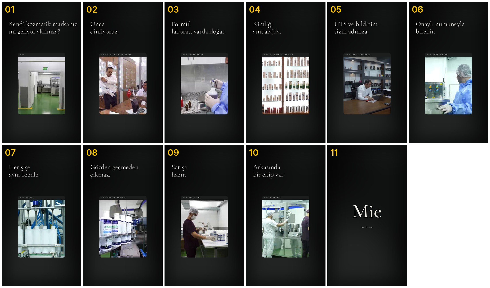

# Aşama 4 — Storyboard (taslak v1)

**Fikir:** Sitedeki 6 adımlık fason süreci (Stratejik Planlama → Formülasyon → Tasarım & Ambalaj → Yasal Kayıtlar → Seri Üretim & KK → Teslimat), gerçek tesis görüntüleriyle adım adım gösterilir. Her pencerenin etiketi = sitedeki adım adı. Uydurma yok.
**Süre:** ~36 sn · 9:16 · koyu şablon, serif başlık, pencerede gerçek görüntü.

| # | Süre | Etiket | Görüntü | Başlık (geçici, Aşama 5'te yazılacak) |
|---|---|---|---|---|
| 01 | 0–3 | — | MIE_3 koridor → üretim | Kanca sorusu |
| 02 | 3–6 | STRATEJİK PLANLAMA | MIE_43 toplantı | |
| 03 | 6–9 | FORMÜLASYON | MIE_6. lab tartım | |
| 04 | 9–12 | TASARIM & AMBALAJ | MIE_45 showroom rafları | |
| 05 | 12–15 | YASAL KAYITLAR | MIE_49 ofis | |
| 06 | 15–18 | SERİ ÜRETİM | YENI_MIE_12 kazan (+MIE_9 hızlı kesme) | |
| 07 | 18–21 | DOLUM | MIE_28 / YENI_MIE_23 | |
| 08 | 21–24 | KALİTE KONTROL | MIE_37 etiketli şişeler | |
| 09 | 24–27 | PAKETLEME | MIE_39 | |
| 10 | 27–31 | EKİBİMİZ | MIE_33 | |
| 11 | 31–36 | — | Logo + tek çağrı (DM: KATALOG) + miepharma.com | |

**Geçişler:** pencere aşağıdan yükselir, görüntü pencere içinde değişir (kart sabit, etiket yazılarak değişir), başlık kelime kelime netleşir.

## Onay bekleyen kararlar
1. Kapanış: koyu zeminde **beyaz** logo mu, yoksa son sahnede **beyaz zemine geçip** orijinal siyah logo mu? (Kapanış videosu beyaz)
2. Vurgu rengi: site turuncu `#ff6418` / IG bordo. Ya da hiç renk yok (siyah-beyaz)?
3. CTA: "DM'den KATALOG yazın" uygun mu?
4. Genel Müdür / toplantıdaki kişilerin görünmesi için izin var mı?
