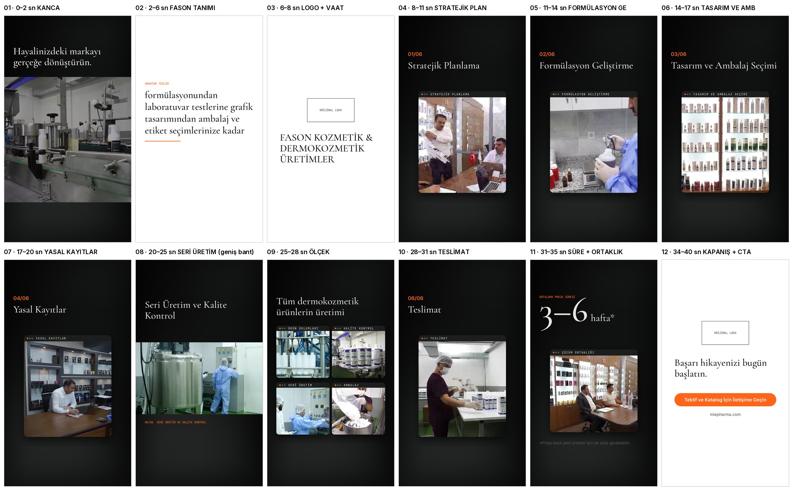

# Aşama 4 — Storyboard v3 (kaynak kuralına göre)

Tüm ekran metinleri birebir site/IG ifadesi. Kaynaklar: `05-metin.md`. Görüntü–adım eşleşmeleri **temsilidir** (müşteriye böyle belirtilecek).
~45 sn · 9:16 · Instagram güvenli alanları boş.

| # | Süre | Düzen | Görüntü | Ekran metni |
|---|---|---|---|---|
| 01 | 0–2 | Geniş bant, dev makine | MIE_30 | Hayalinizdeki markayı gerçeğe dönüştürün. |
| 02 | 2–7 | Beyaz zemin, kelime kelime | — | ANAHTAR TESLİM · formülasyonundan laboratuvar testlerine grafik tasarımından ambalaj ve etiket seçimlerinize kadar |
| 03 | 7–9 | Beyaz zemin, orijinal logo | — | FASON KOZMETİK & DERMOKOZMETİK ÜRETİMLER |
| 04 | 9–13 | Pencere | MIE_43 | 01/06 Stratejik Planlama |
| 05 | 13–17 | Pencere | MIE_6. | 02/06 Formülasyon Geliştirme |
| 06 | 17–21 | Pencere | MIE_45, MIE_44 | 03/06 Tasarım ve Ambalaj Seçimi |
| 07 | 21–25 | Pencere | MIE_49 | 04/06 Yasal Kayıtlar |
| 08 | 25–30 | Geniş bant, hızlı kesmeler | MIE_7, YENI_MIE_10–13, MIE_9, MIE_41 | 05/06 Seri Üretim ve Kalite Kontrol |
| 09 | 30–33 | Çoklu pencere | MIE_28, MIE_38, MIE_9, MIE_34 | Tüm dermokozmetik ürünlerin üretimi · ÜRÜN DOLUMLARI / KALİTE KONTROL / SERİ ÜRETİM / AMBALAJ |
| 10 | 33–37 | Pencere | MIE_39, YENI_MIE_18 | 06/06 Teslimat |
| 11 | 37–41 | Rakam + pencere | MIE_46 | ORTALAMA PROJE SÜRESİ 3–6 hafta* · ÇÖZÜM ORTAKLIĞI · *Proje bazlı yeni ürünler için ek süre gerekebilir. |
| 12 | 41–46 | Beyaz zemin, orijinal logo + CTA | — | Başarı hikayenizi bugün başlatın. · Teklif ve Katalog İçin İletişime Geçin · miepharma.com |

Alt yazı (altyazı bandı): dış ses cümleleri, birebir.
Görsel sistem: orijinal logo · siyah/beyaz/`#555555` · vurgu `#ff6418` · Montserrat (başlık fontu kararı bekliyor).
