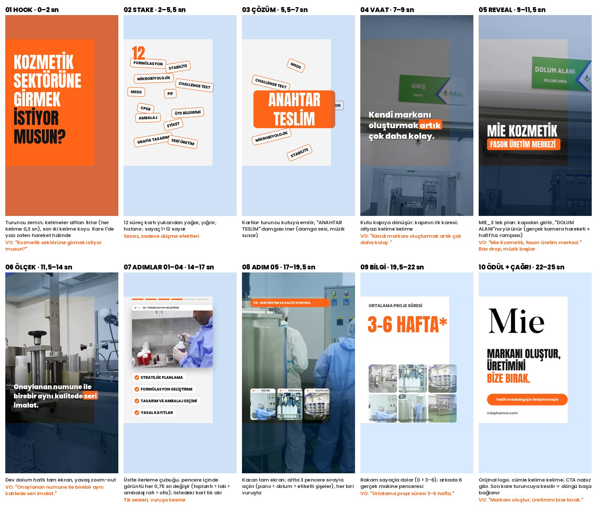

# Aşama 4 — Storyboard v5

Mavi taralı alanlar = Instagram arayüzünün kapattığı bölge (ig-reel kuralı: y<230, y>1440, sağ 230 px). Yazıların hepsi temiz alanda.

## v5'te değişenler
- **Renk:** site paleti. Zemin turuncu `#ff6418` / açık gri `#F4F4F4` / beyaz. Siyah yalnızca logoda ve 2 hook kelimesinde
- **Font:** Reels tipografisi. Başlık **Anton** (yoğun, dar, büyük), altyazı **Poppins Black** + aktif kelime turuncu kutu
- **Görüntü:** 6 klip 1080p (MIE_3, MIE_7, MIE_9, MIE_28, MIE_30, MIE_38). Tam ekran sahneler artık net
- **Logo:** HD siyah "Mie" (`kimlik/logo-mie-siyah-hd.png`)

## ig-reel yapısı (25 sn)
| Bölüm | Süre | Sahne |
|---|---|---|
| HOOK | 0–2 | 01 turuncu zemin, soru (kare 1'de hareket) |
| STAKE | 2–5,5 | 02 12 süreç kartı yağar |
| BODY | 5,5–22 | 03 ANAHTAR TESLİM · 04 vaat · 05 kapıdan giriş (MIE_3 tek plan) · 06 dev dolum hattı · 07 adımlar 01–04 · 08 adım 05 · 09 3-6 hafta |
| PAYOFF + ASK | 22–25 | 10 logo + kapanış cümlesi + tek çağrı |
| LOOP | son kare | Turuncuya kesme; tekrar oynatınca hook'a dikişsiz bağlanır |

Her sahne ≤ 3,5 sn (kare her vuruşta değişir). Ekran kartları ≤ 6 kelime (hook hariç: 5 kelime).

## Hook seçenekleri (ig-reel adım 1–2)
`hookscore.py` / `hooks.json` dosyaları gelmediği için puanlama elle yapıldı.
| # | Formül | Sözlü | Ekranda | Değerlendirme |
|---|---|---|---|---|
| 1 | Kitleyi işaretleyen soru | Kozmetik sektörüne girmek istiyor musun? | KOZMETİK SEKTÖRÜNE GİRMEK İSTİYOR MUSUN? | **Seçildi.** Hesapta aynı soru 100 B izlendi; izleyiciyi ilk kelimede seçiyor |
| 2 | Kolaylık vaadi | Kendi markanı oluşturmak artık çok daha kolay. | ARTIK ÇOK DAHA KOLAY | Güçlü vaat ama kime olduğu belli değil. Vaat olarak 04'te kullanıldı |
| 3 | Rakam | Ortalama proje süresi 3-6 hafta. | 3-6 HAFTA | Somut ama bağlamsız açılışta zayıf. Kanıt olarak 09'da kullanıldı |

## Kaynak tablosu (her ifade birebir)
| İfade | Kaynak |
|---|---|
| KOZMETİK SEKTÖRÜNE GİRMEK İSTİYOR MUSUN? | @mie.fabrika sabit Reels, 11.07.2025 ekran yazısı ("İSTİYOSUN ?"), yazımı düzeltildi |
| FORMÜLASYON, STABİLİTE, MİKROBİYOLOJİK, CHALLENGE TEST, MSDS, PIF, CPSR | @mie.fabrika 28.04.2026 "FASON KOZMETİK ÜRETİM SÜREÇLERİMİZ" + site "Formülasyon Geliştirme" |
| ÜTS BİLDİRİMİ | @mie.fabrika 24.04.2026 "ÜTS BİLDİRİMİ VE SAĞLIK BAKANLIĞI SÜREÇ YÖNETİMİ" |
| AMBALAJ, ETİKET, GRAFİK TASARIM | site /fason-uretimimiz/ "grafik tasarımından ambalaj ve etiket seçimlerinize kadar" |
| SERİ ÜRETİM | site adım 5 "Seri Üretim ve Kalite Kontrol" |
| ANAHTAR TESLİM | @mie.fabrika 05.12.2025 "ANAHTAR TESLİM FASON ÜRETİM HİZMETİ" |
| Kendi markanı oluşturmak artık çok daha kolay. | @mie.fabrika 4 gönderi (29.04, 27.04, 17.04, 09.04.2026) |
| Mie Kozmetik \| Fason Üretim Merkezi | @mie.fabrika bio |
| Onaylanan numune ile birebir aynı kalitede seri imalat | site adım 5 cümlesinden kesit |
| Ortalama proje süresi 3-6 hafta / *Proje bazlı yeni ürünler için ek süre gerekebilir. | site /fason-proje-hazirliklari/ |
| 6 adım adları | site /fason-kozmetik-uretimi/ |
| Markanı oluştur, üretimini bize bırak. | @mie.fabrika 09.04.2026 (hesabın en çok etkileşim alan görseli) |
| Teklif ve Katalog İçin İletişime Geçin | @mie.fabrika bio |
| miepharma.com | IG bio |

Sayaç "12": ekrandaki kart sayısı (iddia değil, ekranda sayılan kartlar).

Metin gerekçesi ve dış ses: `05-metin.md`

## Görüntü kaynağı (önemli)
Videodaki **görüntüler** site ya da Instagram'dan değil, **müşterinin arşivinden** (Drive › MiePharm: OneDrive_2, OneDrive_3, Downloads klasörleri) geliyor. Müşteriye cevap: "Sizin paylaştığınız tesis arşivinden." Metinler: site + @mie.fabrika.
Görüntüde yüzü görünen çalışanlar ve yöneticiler için müşteriden yazılı onay alınmalı.

## Logo
- Kullanılacak: `kimlik/logo-guncel-siyah.webp` (siyah serif "Mie": site, IG profil, kapanış videosu)
- Kullanılmayacak: `kimlik/logo-eski-yesil.webp` (eski logo; tesis tabelalarında ve formalarda görünmesi sorun değil)
- Eldeki siyah logo 280×280 px. Videoda ~600 px genişlikte kullanılacağı için **en az 1200 px PNG ya da SVG** gerekli
